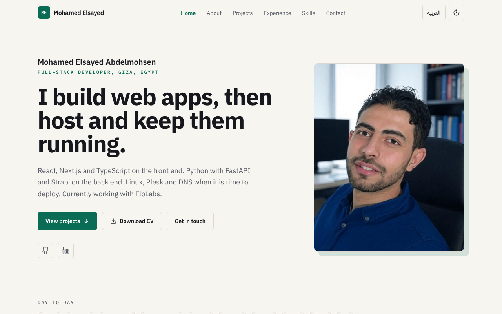
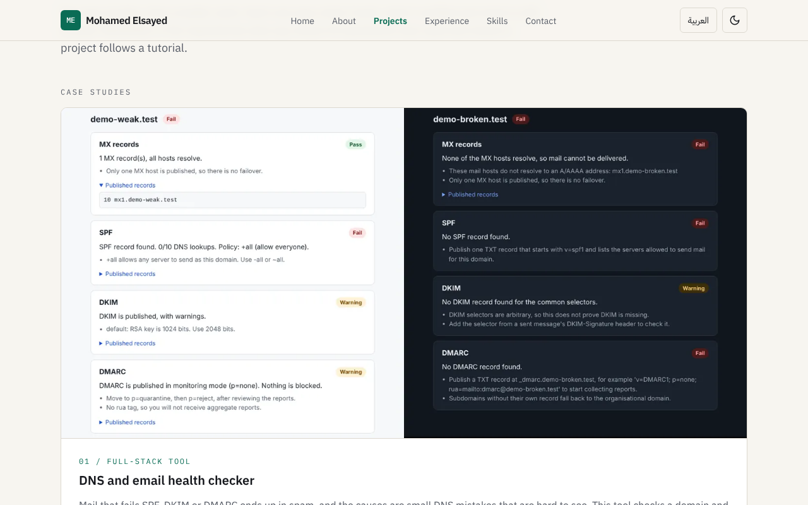
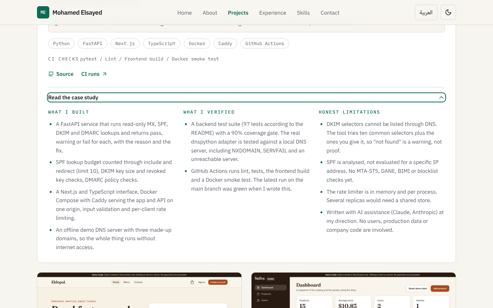
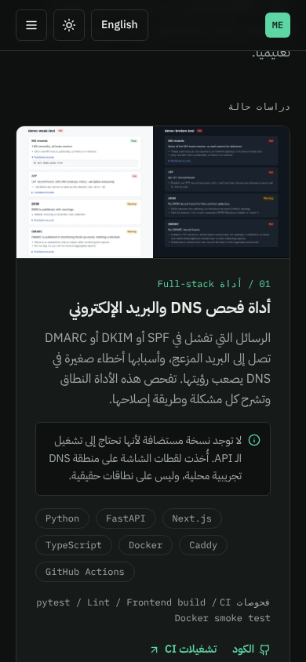

# Mohamed Elsayed Abdelmohsen, portfolio

Personal portfolio of Mohamed Elsayed Abdelmohsen, a full-stack developer in Giza, Egypt (React, Next.js, TypeScript, Python/FastAPI, Strapi, Linux, Plesk and DNS, currently working with FloLabs).

Live site: https://portofolio-xi-wine.vercel.app

| Desktop, light | Projects section, desktop |
| --- | --- |
|  |  |

| A case study opened (keyboard toggle) | Mobile, dark, Arabic (RTL) |
| --- | --- |
|  |  |

## Features

- Single-page site: hero, about (with a "What I bring" block whose points link to evidence), projects, experience, skills, contact.
- Projects are written as case studies: one-line problem, honest status of the live site, stack, the CI checks that run in the repository, links (live, source, CI runs) and a native `<details>` panel with what was built, what was verified and the limitations. Six case studies, eleven smaller projects, and three live demos whose source repositories are private (only their public live link is shown).
- Screenshots are lazy-loaded WebP files with explicit width and height, under 55 KB each, in `project/public/projects/`.
- English and Arabic, with the page direction switching to RTL. The choice is saved in `localStorage`.
- Light and dark theme, saved in `localStorage`, applied before first paint to avoid a flash.
- Keyboard friendly: visible focus rings, semantic landmarks, `aria-current` on the active nav item, Escape closes the mobile menu.
- Respects `prefers-reduced-motion`.
- Fonts (IBM Plex Sans, Mono and Sans Arabic) are self-hosted through `@fontsource`, no CDN.
- All text lives in `project/src/i18n/translations.ts` and project, skill and link data in `project/src/data/portfolio.ts`, so content changes do not touch components. English and Arabic keys are typed to stay in sync.

## Stack

React 18, TypeScript, Vite 5, Tailwind CSS 3, lucide-react. State is plain React context (language and theme). Hosted on Vercel.

## Run locally

```bash
cd project
npm ci
npm run dev        # http://localhost:5201
npm run lint
npm run typecheck
npm run build      # output in project/dist
npm run preview    # serves the build on port 5201
```

No environment variables are needed.

## CI

`.github/workflows/ci.yml` runs `npm ci`, lint, typecheck and build in `project/` on every push and pull request.

## Content notes

- Experience, education and skills follow the owner's resume. No degree in computer science is claimed: the education line is a Bachelor of Law (ongoing) plus self-taught web development and ITI courses.
- Case-study facts come from each repository's README on GitHub and from its GitHub Actions status (checked on 2 Nov 2026). Where a README says something could not be verified, the case study says so too. Examples: the Firebase mode of the Sufra shop was never run against a real Firebase project, the Foodaty store follows a tutorial and its purchase flows were not run, the movie app needs a TMDB token on the host and may show no data without it, and the DNS checker has no hosted demo because it needs a backend.
- Screenshots of the DNS checker, the movie app and the shops were taken against demo DNS data, mock API responses or placeholder images (product photos did not load in the capture environment). The case studies say this.
- Private repositories were inspected only to decide whether a public live site could be listed. Nothing from their source is copied here. Three live sites are listed with a one-line description taken from the code (stack, mock data, demo admin login). Others (a law-school demo with invented testimonials, a duplicate nutrition-store repository, business landing pages and course exercises) were left out on purpose.
- Project descriptions earlier than this version were rewritten to say only what could be confirmed. The fake contact form was replaced by direct contact links, and stock photos used as thumbnails were removed.

## Verification and limitations

Verified by running `npm run lint`, `npm run typecheck` and `npm run build` (all pass), and by driving the dev server with Playwright at 1280x800 and 390x844 in light, dark, English and Arabic: no console errors or warnings, no horizontal overflow, no broken images, `dir` switches to RTL in Arabic, the case-study panels open with the keyboard, and language and theme toggles work.

Not verified: the external project links (live demos and GitHub repositories) were not opened from the build environment, because outside network access was blocked, so the "live" status lines come from each repository's README. The test counts quoted in the DNS checker case study (97 tests, 90% coverage gate) are taken from its README and CI results, and I did not re-run them here. Arabic copy was written alongside the English and has not had a native-speaker review. Automated tests were not added, since the site has no non-trivial logic.

## Notes

UI and code quality improvements were made with AI assistance (Claude, Anthropic), reviewed and verified by building and running the app.
